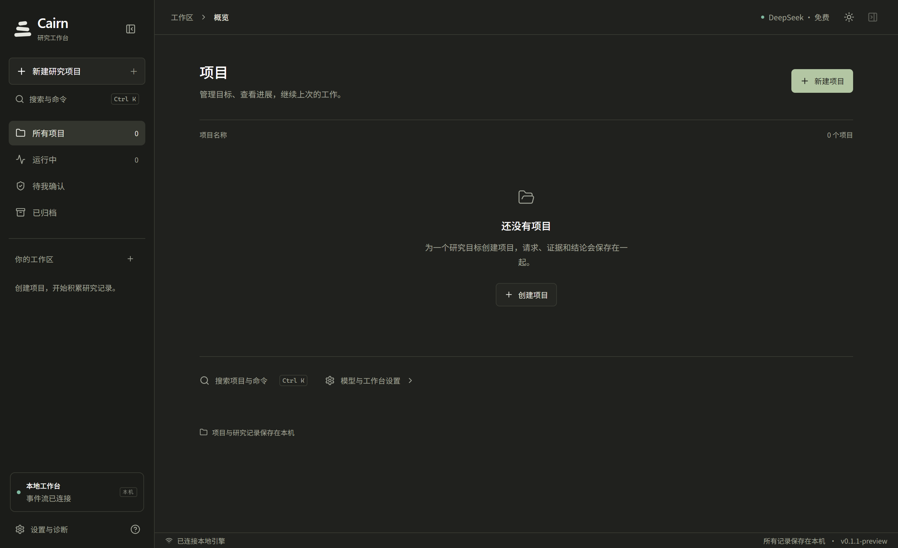

# Cairn Workbench

中文优先的本地安全研究工作台。基于 Cairn 的事实／意图／提示模型，增加 Windows 桌面端、实时活动流、逐次审批、证据与发现管理。

[下载 Windows 预览版](https://github.com/0xMouise/cairn-workbench/releases/tag/v0.1.1-workbench-preview) · [验证记录](docs/VALIDATION.md) · [架构与边界](docs/WORKBENCH_ARCHITECTURE.md)



[浅色界面](docs/images/workbench-light.png) · [深色界面](docs/images/workbench-dark.png) · [0.1.1 界面更新](docs/RELEASE_NOTES_0.1.1.md)

## 主要功能

- Windows Tauri 桌面窗口、托盘、窗口恢复；后台任务独立运行。
- 深浅主题、项目工作区、快捷搜索、可调整面板、可回放探索图。
- OpenCode Server API 实时执行、关键操作逐次确认、停止与显式新尝试。
- HAR / OpenAPI JSON 导入、范围校验、审批后 HTTP 重放。
- 项目身份加密存储、证据 SHA-256、人工复核发现、脱敏报告。
- Markdown / HTML / PDF 报告直接下载。
- 手动项目终端、诊断导出、数据库与完整离线备份、旧版数据导入。

## Windows 使用

需要 Windows x64、WebView2、WSL Kali（发行版名称 `kali-linux`）、Python 3.12+ 和 Node.js。预览版安装包未签名。

安装桌面包后启动应用；缺少后台服务时，应用提供安装入口。它会先说明依赖，再经用户点击确认安装。已经安装后台的环境直接启动服务。

源码安装：

```powershell
powershell -ExecutionPolicy Bypass -File scripts/Install-Workbench.ps1
powershell -ExecutionPolicy Bypass -File scripts/Start-Workbench.ps1
# 浏览器入口
powershell -ExecutionPolicy Bypass -File scripts/Start-Workbench.ps1 -Browser
```

默认地址 `http://127.0.0.1:18100`。使用启动入口自动交换本机令牌；令牌通过 URL fragment 传递后立即移除，不发送为查询参数。原版 Cairn 的 18000 端口和数据保持独立。

## 开发与验证

```powershell
cd web
npm ci
npm run build
python ../scripts/package_runtime.py
# 在 Visual Studio x64 开发终端中；Rust stable + Windows C++ Build Tools
npm run tauri build
```

后端：创建 Python 虚拟环境，安装 `pip install -e ./cairn pytest httpx`，运行 `python scripts/serve_workbench.py`。生产环境使用独立 WSL 虚拟环境。

`CAIRN_WORKBENCH_DATA` 设置数据目录。默认 `~/.local/share/cairn-workbench`。`CAIRN_OPENCODE_BIN` 设置 OpenCode 路径；`CAIRN_OPENCODE_AUTH` 可指定现有 OpenCode auth.json。凭据由后端复制到私有项目配置，界面不会显示。

后端测试在 Linux/WSL 运行 `pytest cairn/tests`。浏览器验收先启动独立测试后端，再在 web 运行 `npm run test:e2e`；本机使用 Edge，CI 使用 Playwright Chromium。

## 模型和权限

默认 `opencode/deepseek-v4.1-flash-free`，辅助模型同样使用免费型号。服务商可调整免费额度和型号可用性。额度不足会进入 `quota_blocked`，不会无限重试或切换付费型号。

任意 Shell、文件修改及网络工具默认请求确认；项目只读工具可自动运行。每个批准只用于当前请求。受控工作者不启用自动批准模式，也不启用子 Agent 工具。

WSL 当前用户权限模式不是系统沙箱。手动终端中的命令由用户输入后直接执行。停止任务与历史回放不会撤销已产生的外部修改。

## 备份与导入

停止后台后运行完整备份或恢复：

```bash
python scripts/backup_workbench.py backup ~/.local/share/cairn-workbench workbench.tar.gz
python scripts/backup_workbench.py restore /new/empty/data workbench.tar.gz
python scripts/migrate_legacy.py /path/to/legacy/cairn.db ~/.local/share/cairn-workbench
```

备份包含身份密钥和本机访问令牌，请作为敏感文件保管。界面中的「备份数据库」只备份 SQLite；完整恢复还需要项目文件和身份密钥。新版本迁移前先保存完整备份。

## 开源与发布

保留 Cairn 的 AGPL-3.0 许可和上游版权。新增代码随本项目按 AGPL-3.0 分发。第三方声明见 THIRD_PARTY_NOTICES.md。上游项目说明保留在 README.upstream.md。

当前为预览版。真实免费模型任务、Windows 干净环境首次安装、长期性能和稳定版签名分别验收；未通过项应在发行说明中明确列出。
